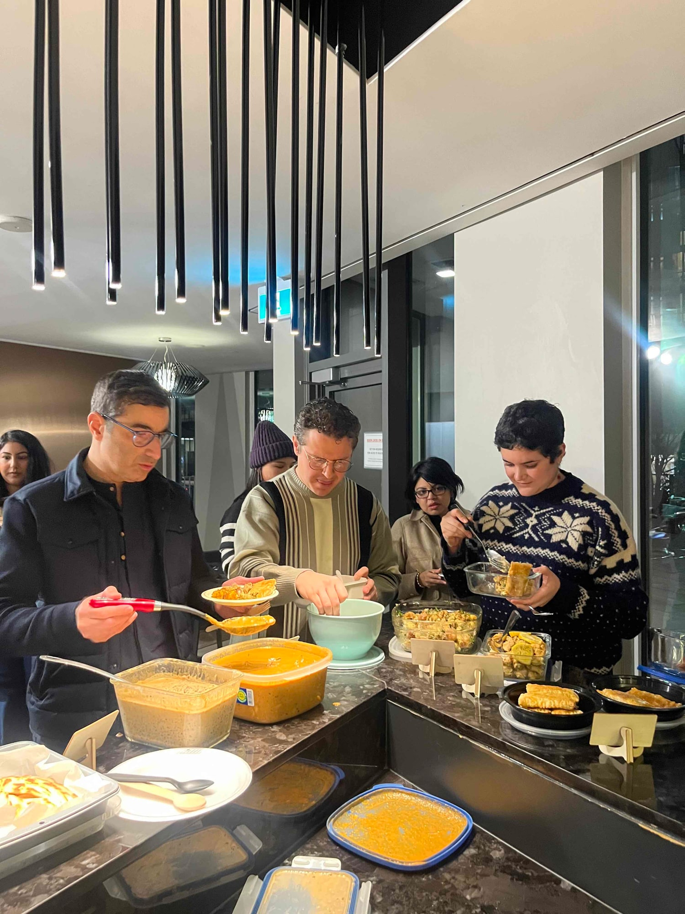
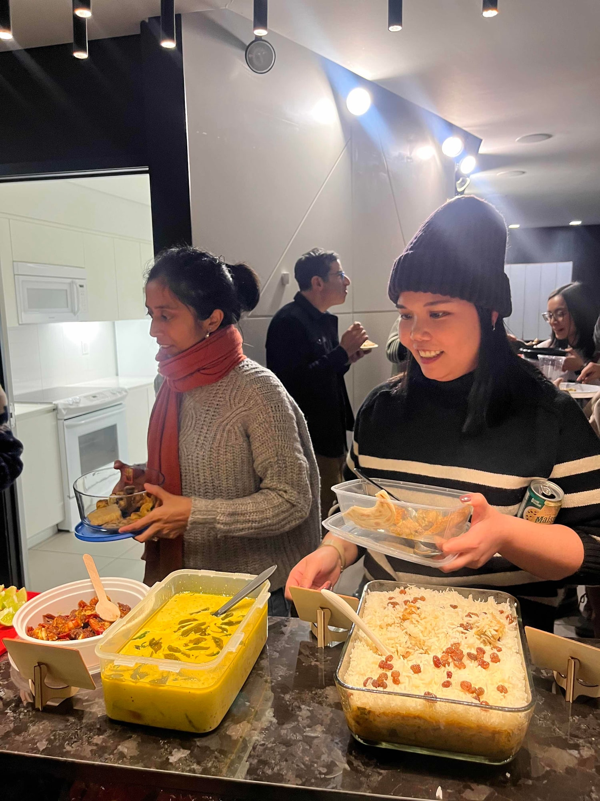
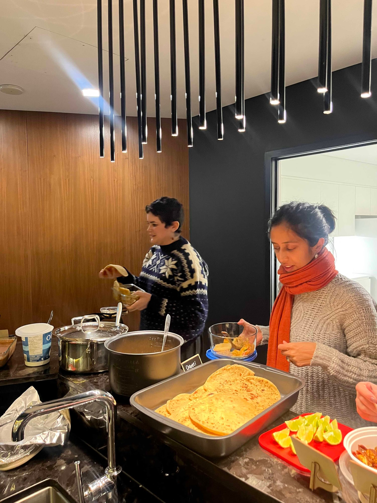
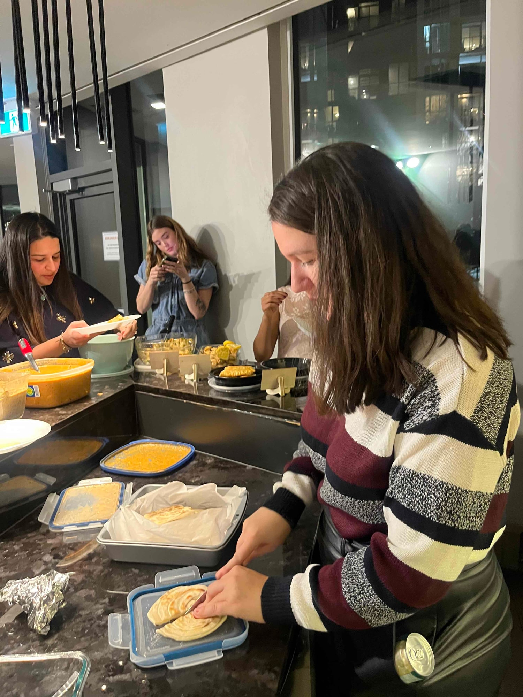
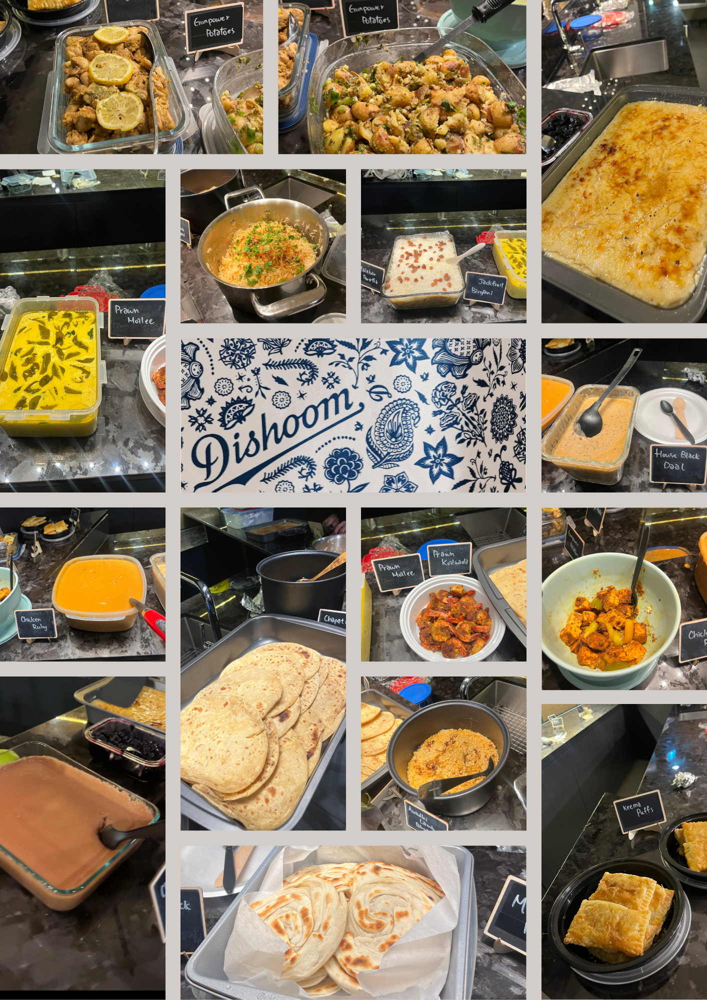

Some cookbooks people own. *Dishoom* is one people have opinions about. It is the book from the Bombay cafe restaurants in London, and it asks for time in a way most of our picks do not. Nearly everyone arrived saying they had wanted to cook their dish for years and had finally been given an excuse.

The room smelled extraordinary before anything was served, which is usually a good early indicator. The house black daal was there, and around it chicken ruby, gunpowder potatoes, a prawn moilee sitting bright yellow in its container, prawn koliwada, jackfruit biryani, keema puffs. Somebody had taken on the breads, which is its own quiet act of service, and a stack of chapati and a tray of blistered malabar paratha meant everyone could actually eat everything else. Dessert was a chocolate mousse in a tray big enough for the whole room.

I will admit most of it was too spicy for me and I spent a fair part of the evening quietly working through a chapati. But I had made a rice pudding, and the Indian guests told me it tasted authentic, which was the only review I was ever going to remember.

One of the more ambitious months we have had, and one of the best.

We run one of these every month. [Subscribers get the link](/contact) before spots open to everyone.

