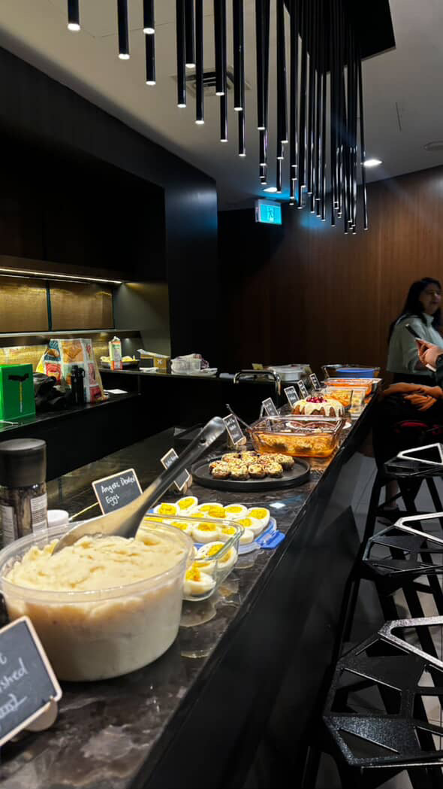
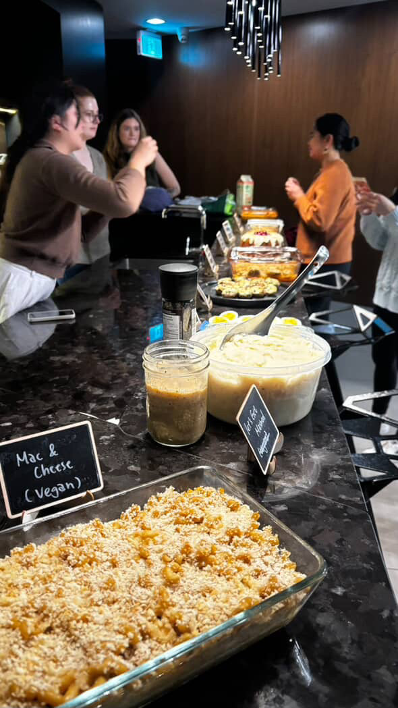
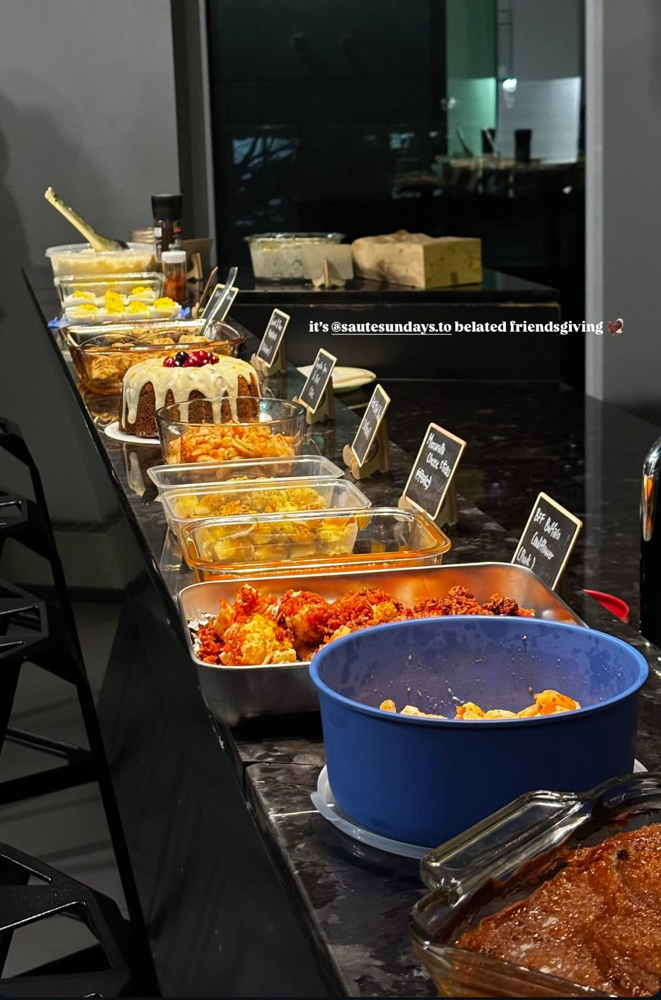
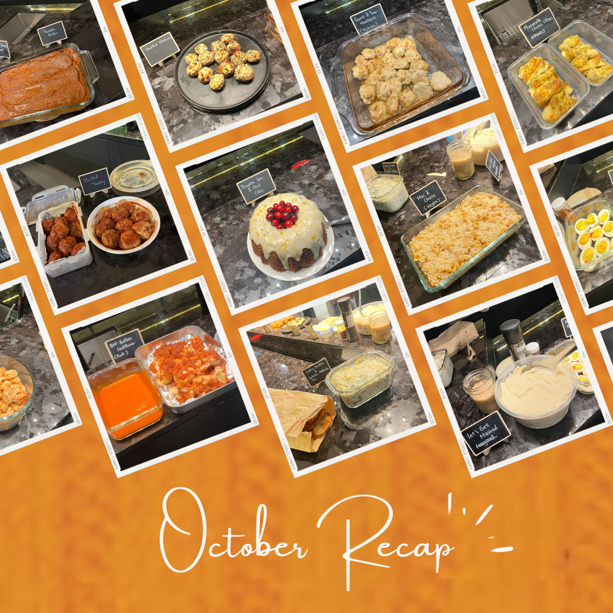

If any month needed no explanation, it was this one. Everyone brings a dish and eats together; that is basically Thanksgiving with extra steps. *The Friendsgiving Cookbook* was built for exactly that.

Nobody made a turkey and nobody missed it. It was all the parts of Thanksgiving people actually go back for: sweet and sour meatballs, a mac and cheese nobody clocked as vegan until they were told, buffalo cauliflower with its own bowl of sauce, deviled eggs, stuffed mushrooms, mozzarella bites, and a tub of potatoes labelled Let's Get Mashed. Bana's Pumpkin Spice and Chill Cake came out under a crown of fresh cranberries and was the best looking thing on the counter all night, for roughly eleven minutes.

We called it the stress-free edition for people who were not confident cooks yet. Thanksgiving is an easy entry point: everyone already knows how to make at least one thing for the table, and nobody is being judged on a side.

It was also the first one that felt properly like autumn. Everyone came in from the cold and stayed far longer than planned.

We run one of these every month. [Subscribers get the link](/contact) before spots open to everyone.

