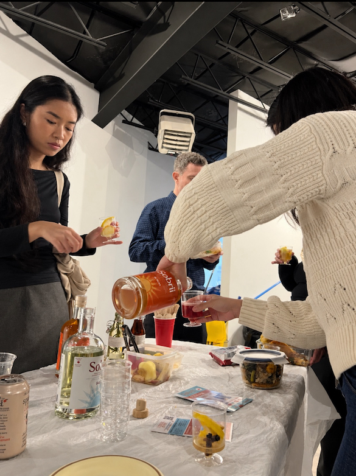
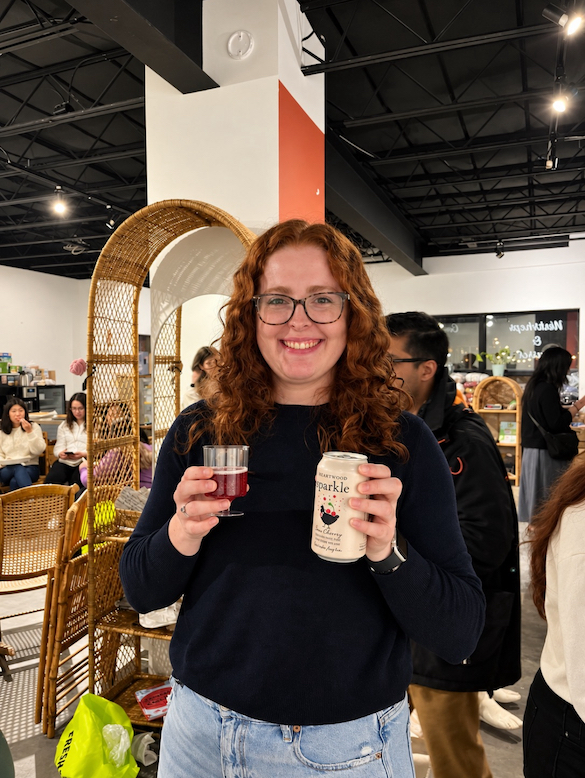
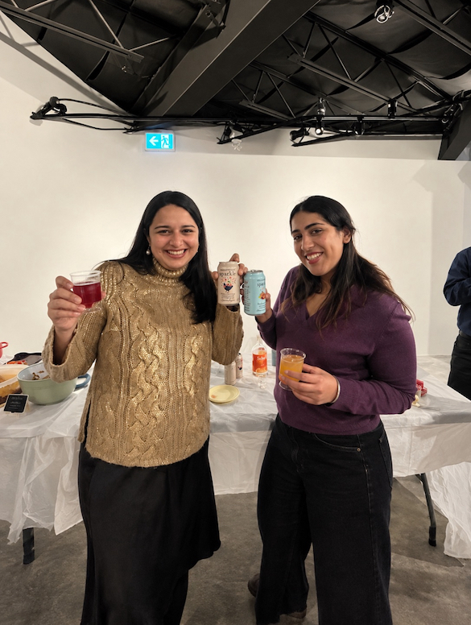
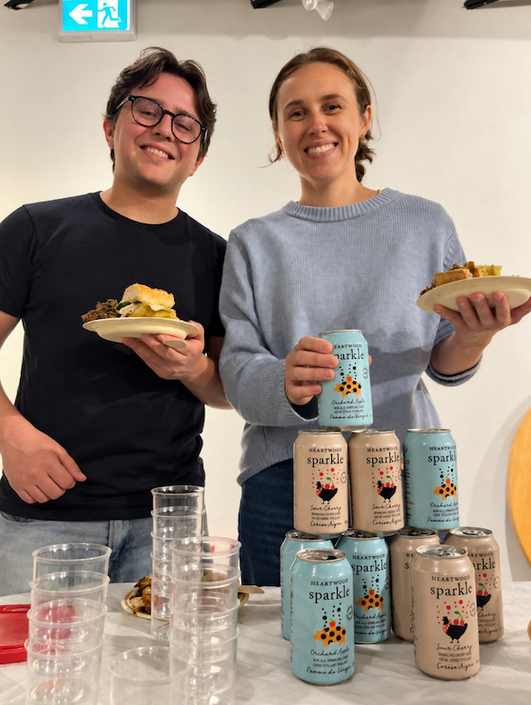
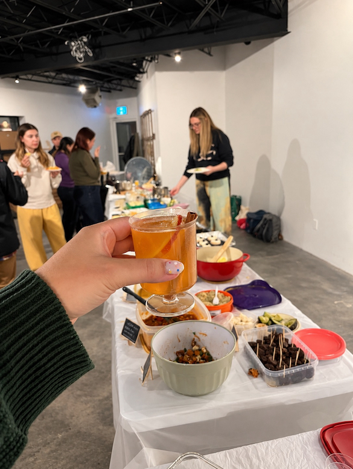

import InstagramEmbed from "../../../components/InstagramEmbed.astro";

Friendsgiving fell on October 18 this year, the Sunday after Thanksgiving. I hope you got to spend the long weekend with the people you wanted to spend it with, and that there was something on your list to be thankful for this year.

One of mine is easy. It's everyone who came to Jrew's with their favourite dish. October sold out to newsletter subscribers within six hours, before spots ever opened to the public.

October was the first night we've run without a featured cookbook. Instead, we asked everyone to bring a recipe they love, whether that came from a cookbook they keep going back to, a family recipe, or the dish they always end up bringing to the holidays.

## The DIY mocktail bar

We also set up a free DIY mocktail bar for the night with our sponsors, <a href="https://heartwoodfarm.ca" target="_blank" rel="sponsored noopener">Heartwood Farm</a> and <a href="https://sobrii.ca/" target="_blank" rel="sponsored noopener">Sobrii</a>, and it got a lot more love than I expected. People kept drifting back to it all night to try another combination, which is exactly what I was hoping for when we set it up.

<InstagramEmbed url="https://www.instagram.com/reel/DeuCFK5xv-O/" />

## What I ate, as far as I know

I do have a confession. I spent most of the night standing at that bar taking photos for Heartwood Farm and Sobrii, so my husband was the one bringing me plates. I genuinely don't know what I ate for a good chunk of the evening. All of it was good, I just couldn't tell you whose it was. It's also why there are more photos of drinks than food from this one, and why the reel above catches more of the night than I did.

The three I got up and grabbed myself were the pumpkin pie, the Earl Grey cupcakes, and a chicken liver pâté I did not see coming. Someone made pâté. For a potluck. I'm still thinking about it.

So if your dish isn't named here, that's my fault for spending the night behind the bar. Send us a message on [Instagram](https://www.instagram.com/sautesundays.to/) and tell me what you brought, and I'll make sure it gets a mention next time.

## Two babies at a potluck

We also had two babies at this one. I'd been hoping that would happen eventually, and I loved it. We're officially an all ages event now.

We run one of these every month. [Subscribers get the link](/contact) before spots open to everyone.
